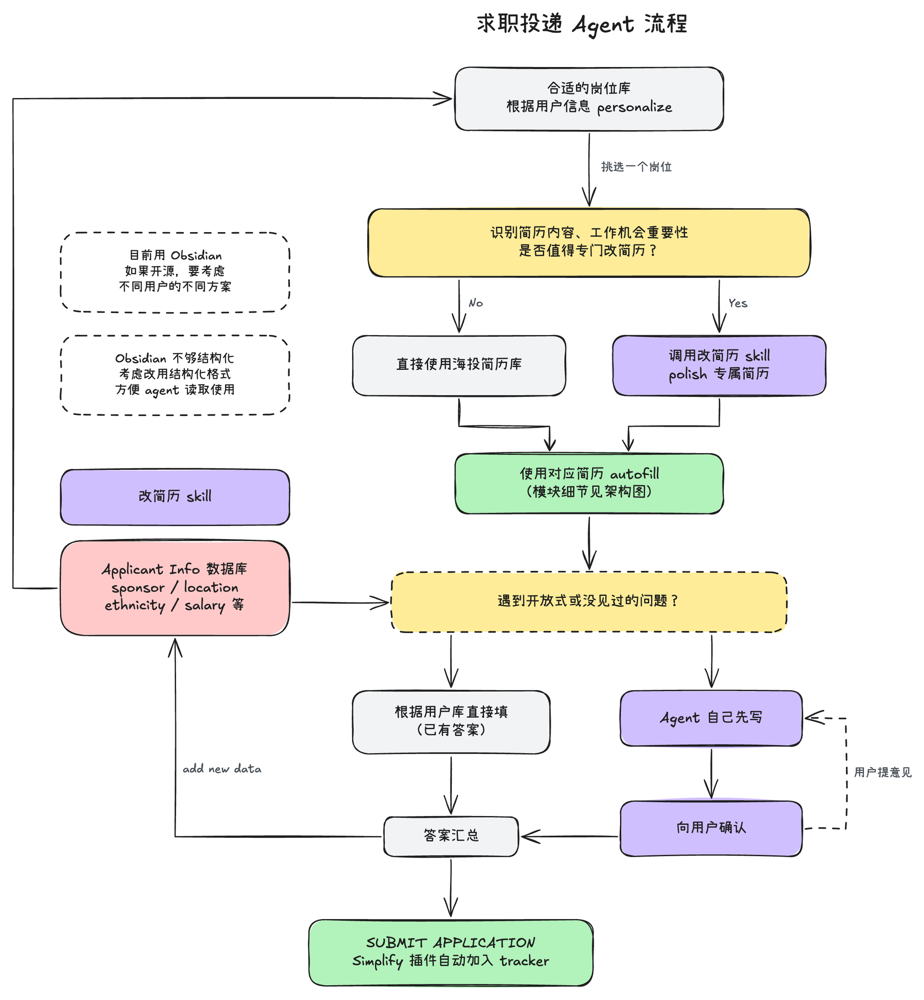
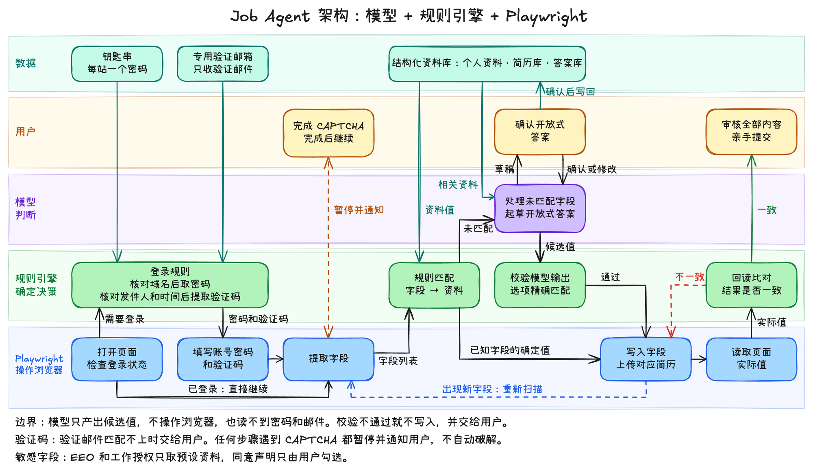

# Job Agent

Job Agent helps you apply for jobs. It selects a resume for each job and fills the application form. You review the form and submit it.

## Application flow



1. The agent selects a job from a personalized job list.
2. The agent examines the job and decides if the job needs a special resume.
3. The agent uses a resume from the general resume library, or it makes a special resume with a resume skill.
4. The agent fills the form with the selected resume.
5. The agent uses saved answers for known questions. For a new question, the agent writes a draft and you approve it.
6. The agent saves new answers in the applicant data.
7. You submit the application.

## Architecture

The agent has three layers. Playwright is a library that operates a browser. A CAPTCHA is a test that identifies a human user.



| Part | Function |
| --- | --- |
| Playwright | Opens the page, reads the fields, writes the values, and reads the values again. |
| Rule engine | Matches fields to applicant data, checks model output, and compares the page values with the expected values. |
| Model | Writes candidate values for fields that have no rule, and writes drafts for open questions. |
| User | Completes each CAPTCHA, approves drafts, and submits the application. |

The agent keeps each site password in the macOS Keychain. It gets verification codes from a dedicated mailbox. Rules do these two tasks, and the model cannot read passwords or email.

## Status

| Part | Status |
| --- | --- |
| Rule engine and Playwright form fill | Available |
| Readback of page values | Available |
| Login and verification codes | Planned |
| Model for fields that have no rule | Available. Tested with `claude-sonnet-5-5` on one real form. The OpenAI-compatible option is tested with a local test server only. |
| Job list and resume selection | Planned |

## Run the form fill

Prerequisites:

- Node.js
- Google Chrome

Procedure:

1. Install the dependencies:

   ```bash
   npm install
   ```

2. Copy the example profile:

   ```bash
   cp examples/profile.example.json profile.local.json
   ```

3. Enter your data in `profile.local.json`.

4. Fill a form:

   ```bash
   node src/fill.mjs "<form-url>" profile.local.json path/to/resume.pdf
   ```

5. Examine the report in the terminal. The report shows the filled fields and the fields that you must complete.

6. Complete the form in Chrome and submit it.

7. Close Chrome.

## Use a model

The model completes required fields that have no rule. It gets the field labels, the field options, the first part of the page text, and the `model_context` section of your profile.

The agent does not send sensitive questions or the other profile values to the model.

Prerequisites:

- An API key, or a local model server
- Your data in the `model_context` section of `profile.local.json`

Procedure:

1. Set the model configuration. Use one of these two configurations:

   - Claude:

     ```bash
     export ANTHROPIC_API_KEY="<your-key>"
     ```

   - A server that uses the OpenAI chat completions API:

     ```bash
     export JOB_AGENT_PROVIDER="openai-compatible"
     export JOB_AGENT_BASE_URL="<server-url>"
     export JOB_AGENT_MODEL="<model-name>"
     export JOB_AGENT_API_KEY="<your-key>"
     ```

2. Fill a form with the `--model` option:

   ```bash
   node src/fill.mjs "<form-url>" profile.local.json path/to/resume.pdf --model
   ```

3. Examine each draft in the terminal. Accept, edit, revise, or skip the draft.

4. Complete the form in Chrome and submit it.

To use a different Claude model, set `JOB_AGENT_MODEL`. The default model is `claude-sonnet-5-5`.

The agent writes a model answer that has options only if the answer matches one option exactly. The agent saves the drafts that you approve in `profile.local.json`.

## Test

Run the tests:

```bash
npm test
```

## Documents

- [Editable flowcharts](docs/flowchart/): Open the `.excalidraw` files at [excalidraw.com](https://excalidraw.com).
- [Roadmap](docs/roadmap.md)

## License

[MIT](LICENSE)
