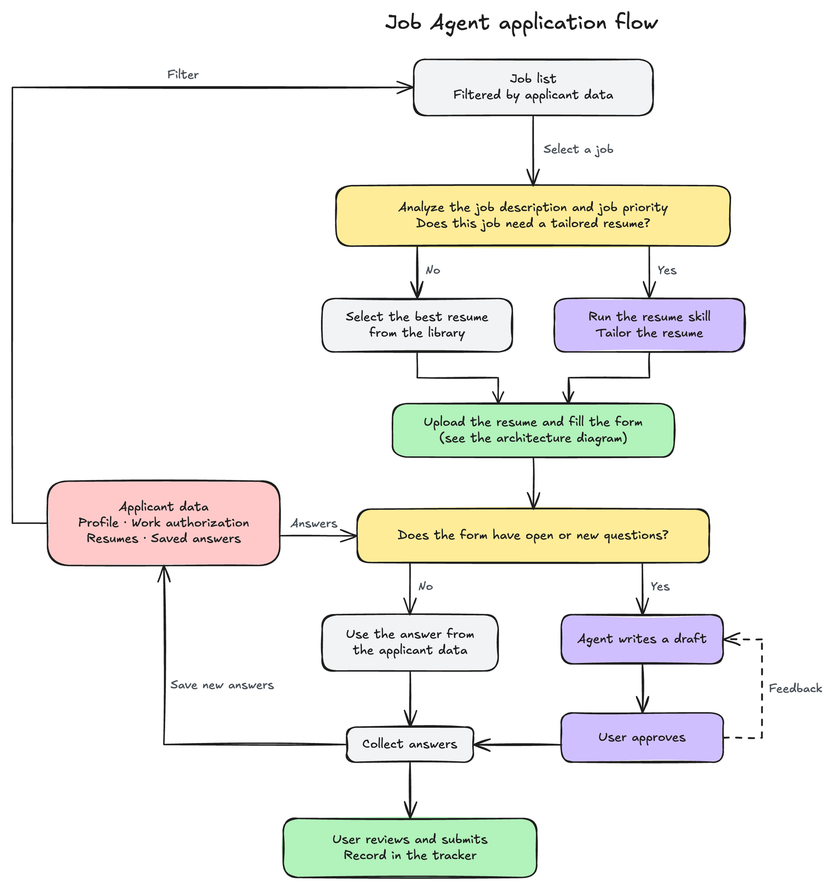
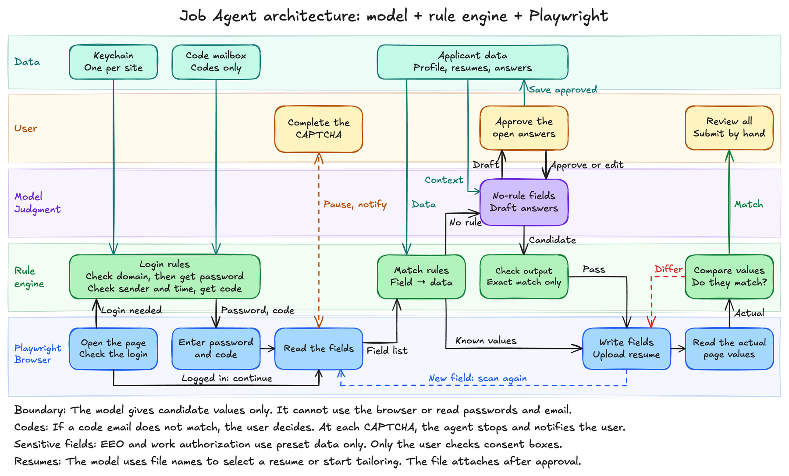

# Job Agent

[English](README.md) | [简体中文](README.zh-CN.md)

Job Agent helps you apply for jobs. It selects a resume for each job and fills the application form. As an option, it can make a tailored resume. By default, you review the form and submit it. You can also set the agent to sign and submit it.

## Application flow



1. The agent selects a job from a personalized job list.
2. The agent examines the job and decides if the job needs a tailored resume.
3. The agent selects a resume from your library. If you enable tailoring, it can run a resume skill to make a tailored resume.
4. The agent uploads the resume after you approve it, then fills the form.
5. The agent uses saved answers for known questions. For a new question, the agent writes a draft and you approve it.
6. The agent saves new answers in the applicant data.
7. You submit the application, or the agent submits it if you enable this function.

## Architecture

The agent has three layers. Playwright is a library that operates a browser. A CAPTCHA is a test that identifies a human user.



| Part | Function |
| --- | --- |
| Playwright | Opens the page, reads the fields, writes the values, and reads the values again. |
| Rule engine | Matches fields to applicant data, checks model output, and compares the page values with the expected values. |
| Model | Selects a resume, starts tailoring, writes candidate values for fields that have no rule, and writes drafts for open questions. |
| User | Completes each CAPTCHA, approves resumes and drafts, answers follow-up questions, and submits the application. |

The login design keeps each site password in the macOS Keychain and gets verification codes from a dedicated mailbox. Rules do these two tasks, and the model cannot read passwords or email.

## Status

| Part | Status |
| --- | --- |
| Rule engine and Playwright form fill | Available |
| Automatic signature and submission | Available. Tested on local forms only. |
| Legal and demographic answers, and saved follow-up answers | Available. Tested on local forms only. |
| Readback of page values | Available |
| Setup from questions and documents | Available. Tested with `claude-sonnet-5-5` and fictional documents. |
| Model for fields that have no rule | Available. Tested with `claude-sonnet-5-5` on one real form. The OpenAI-compatible option is tested with a local test server only. |
| Resume selection and upload | Available. Selection is tested with `claude-sonnet-5-5`. Upload is tested on local forms only. |
| Automatic tailoring (optional) | Available for Claude Code only. Tested with one real job page. |
| Login and verification codes | Planned |
| Job list and tracker | Planned |

## Get started

Prerequisites:

- Node.js
- Google Chrome

Procedure:

1. Install the dependencies:

   ```bash
   npm install
   ```

2. Start the setup:

   ```bash
   node src/setup.mjs
   ```

3. Answer the questions in the terminal.

4. Fill a form:

   ```bash
   node src/fill.mjs "<form-url>"
   ```

5. Examine the report in the terminal. The report shows the filled fields and the fields that you must complete.

6. Complete the form in Chrome and submit it.

7. Close Chrome.

## Enter your data

You do not need to edit a file. The setup collects your data in two ways:

- **Documents:** Enter the path of a resume or a folder. The setup reads PDF, Word (`.docx`), text, and Markdown files. In a folder, it reads the files at the top level only.
- **Questions:** The setup asks for each value that it did not find.

Each value from a document is a suggestion. You can accept it, change it, or clear it.

Without a model, the setup finds only your email, phone, LinkedIn, and GitHub in the documents. With a model, it finds more values. It shows the file names and asks for your approval before it sends text to the model.

The setup always asks you directly about work authorization, sponsorship, visa type, and demographic questions. It does not take these answers from a document.

## Legal and demographic answers

The setup saves your answers to these questions. The agent then uses these rules for each form.

| Question | Rule |
| --- | --- |
| Work authorization and sponsorship | The agent uses your yes or no answer in the regions that you enter. If a question names a different region, the agent asks you. |
| Demographic questions | If you select "decline", the agent selects the option to decline. If the form has no such option, it uses your preset answer. If you have no preset answer, it asks you. |
| "Have you worked here" | The agent compares your list of companies with the question, the URL, and the page headings. It selects "Yes" if it finds a match. Otherwise it selects "No". |

The agent asks you about follow-up questions, such as the type of visa that you will need. It saves your answer in `profile.local.json` and does not ask the same question again. It also uses the answer for a nearly identical question. The saved answers go on the form, and you examine the form before you submit it.

The profile does not store passwords or social security numbers. The model does not get these questions, demographic questions, visa questions, or questions that ask for all the schools that you attended.

## Sign and submit automatically

When the setup asks if the agent should sign and submit, enter `y`. The agent then does these steps after it fills the form:

1. It checks each required checkbox that accepts terms or certifies your data. It leaves optional checkboxes empty.
2. It types your full name in signature fields and the current date in signature date fields.
3. It examines the form. It does not submit if a required field is empty or if the page does not show an expected value.
4. It clicks the submit button one time.
5. It looks for the confirmation on the page and records the result in the report.

If the page shows a CAPTCHA or asks for a verification code, you must complete it in Chrome. The agent then continues to look for the confirmation.

To fill a form and not submit it, use the `--no-submit` option:

```bash
node src/fill.mjs "<form-url>" --model --no-submit
```

At the end, the command shows a short summary: the result, the resume, and the answers to examine. To see the full report in JSON (JavaScript Object Notation), add the `--json` option.

An application that the agent submits is an application from you. Examine your profile before you enable this function.

### Import your applications to Simplify

The agent cannot write to the Simplify Job Tracker. When the agent finds the confirmation of a submission, it adds one row to `applications.local.csv` in the current folder. An application that you submit yourself does not get a row. Git ignores this file.

To import the file:

1. In the Simplify Job Tracker, select **Import CSV**.
2. Select `applications.local.csv`.
3. Map each column to the tracker field. Map `Company`, `Position Title`, `Status`, `Posting Link`, and `Notes`. The application date is in `Notes`.
4. Examine the preview. If a row does not have a company, enter the company or skip the row.
5. Complete the import.
6. Move `applications.local.csv` to the Trash. The next submission makes a new file. If you import the same rows again, you get duplicate records.

The setup saves your data in `profile.local.json`. Only your user account can read this file, and Git ignores it. To change your data, run the setup again. The setup keeps your saved answers.

If `profile.local.json` does not exist, `src/fill.mjs` starts the setup first.

## Use a model

The model completes required fields that have no rule. It gets the field labels, the field options, the first part of the page text, and the `model_context` section of your profile.

The agent does not send sensitive questions or the other profile values to the model.

Prerequisites:

- An API key, or a local model server

Procedure:

1. Set the model configuration. Use one of these two configurations:

   - Claude:

     ```bash
     export ANTHROPIC_API_KEY="<your-key>"
     ```

   - A server that uses the OpenAI chat completions API:

     ```bash
     export JOB_AGENT_PROVIDER="openai-compatible"
     export JOB_AGENT_BASE_URL="<server-url>"
     export JOB_AGENT_MODEL="<model-name>"
     export JOB_AGENT_API_KEY="<your-key>"
     ```

2. Fill a form with the `--model` option:

   ```bash
   node src/fill.mjs "<form-url>" --model
   ```

3. Examine each draft in the terminal. Accept, edit, revise, or skip the draft.

4. Complete the form in Chrome and submit it.

To use a different Claude model, set `JOB_AGENT_MODEL`. The default model is `claude-sonnet-5-5`.

The agent writes a model answer that has options only if the answer matches one option exactly. The agent saves the drafts that you approve in `profile.local.json`.

## Select a resume

The agent selects a resume from your resume folders. You do not need a special data format. Use folder and file names that describe each resume.

Prerequisites:

- A model configuration
- A folder of general resumes, with one subfolder for each category
- A folder of targeted resumes, with one subfolder for each company and role. Start each subfolder name with your name, then the company. For example: `Alex_Rivera_Acme_Backend`.

Procedure:

1. Enter the two folders when the setup asks for them.

2. Fill a form with no resume path:

   ```bash
   node src/fill.mjs "<form-url>" --model
   ```

3. Examine the recommended resume in the terminal.

4. Accept the resume, enter a resume id or a path, or skip the upload.

The agent attaches a file only after you approve it. Some forms upload the file immediately when the agent attaches it.

The model gets the file names and folder names. It does not get the resume content or the local paths. The agent offers a targeted resume only if the job page or URL contains the company name.

To use a specified resume, enter the profile and the resume path:

```bash
node src/fill.mjs "<form-url>" profile.local.json path/to/resume.pdf --model
```

## Tailor a resume automatically (optional)

People make tailored resumes in different ways. Some people use their own agent. Other people edit the resume in a chat window. This function shows one method as a reference: Claude Code with a resume skill. This project does not include a resume skill. You must supply your own.

If you do not use this function, all the other steps stay the same. The agent selects a resume from your folders, but it does not make a new resume for a job. To use a tailored resume that you made, enter its path when the agent shows the resumes.

When the model recommends tailoring, the agent starts your resume skill. You do not start the skill or enter a path. The agent then shows you the new resume for approval.

Prerequisites:

- [Claude Code](https://claude.com/claude-code), with a login
- A resume skill for Claude Code
- A rule that tells the agent which jobs need tailoring

Procedure:

1. Run the setup. Enter `y` when it asks if you want automatic tailoring. Then enter these items:

   - The jobs that need a tailored resume
   - The name of the resume skill
   - The folders with your source material

2. Fill a form:

   ```bash
   node src/fill.mjs "<form-url>" --model
   ```

3. Wait for the tailored resume. This can take several minutes.

4. Read the new resume and the notes in the terminal. The notes show the changes and the claims to examine.

5. Accept the resume, enter a different resume, or skip the upload.

The agent saves the PDF, its source file, `job.txt`, and `tailor.log` in a new folder in your targeted resume folder.

Limits for each run:

- The tool can write only in the new folder. An operating system sandbox applies this limit to the commands that the tool runs.
- The tool has no network access.
- The Read tool of the tool can read only the material folders and the skill folders. The LaTeX commands can read other files, so read the PDF before you accept it.
- If the sandbox is not available, the tool does not start.
- The tool does not get the API keys from the agent. It uses its own login.
- The tool stops after 15 minutes or at a cost of 5 USD. To change these limits, set `timeout_minutes` and `max_budget_usd` in `resume_library.tailor`.

If tailoring fails, the agent shows the error and recommends a resume from your library.

To remove this function from the code, delete `src/tailor.mjs` and `test/tailor.test.mjs`. The other steps do not use these files.

## Test

Run the tests:

```bash
npm test
```

## Documents

- [Editable flowcharts](docs/flowchart/): Open the `.excalidraw` files at [excalidraw.com](https://excalidraw.com). Each diagram has an English file (`.en`) and a Chinese file (`.zh`).
- [Roadmap, in Chinese](docs/roadmap.md)

## License

[MIT](LICENSE)
