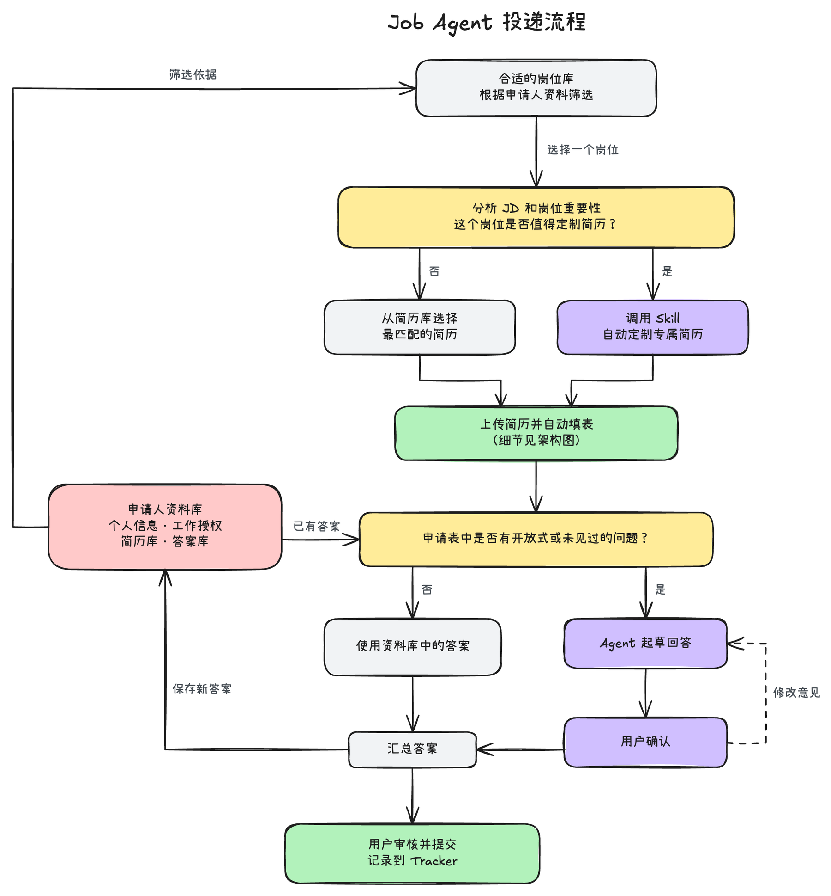
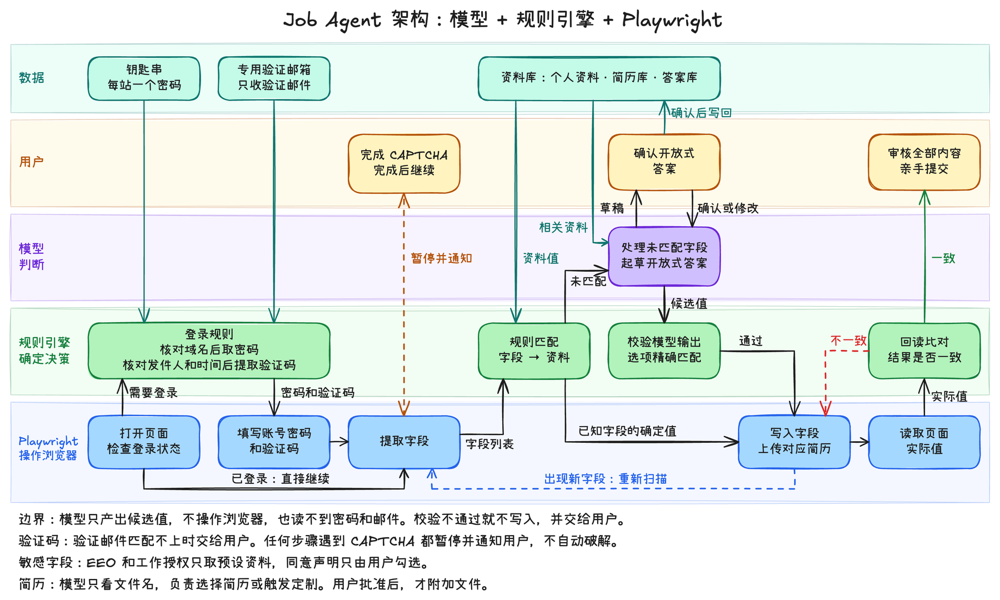

# Job Agent

[English](README.md) | [简体中文](README.zh-CN.md)

Job Agent 是一个完全接管你的投递简历流程的ai agent。它能够为你挑选合适的岗位，并为其选择简历、填写申请表。你甚至也可以利用内置的skill让它为某个岗位定制简历。最后Agent会自动为你提交申请表，当然，如果你不放心的话，也可以修改为手动检查并提交。

## 投递流程



1. Agent 从个性化岗位库中选择一个岗位。
2. Agent 分析岗位，判断这个岗位是否需要定制简历。
3. Agent 从简历库选择简历。如果启用了定制，它也可以调用简历 Skill 定制一份。
4. 你批准简历后，Agent 上传简历并填写表格。
5. 已知问题使用已保存的答案。遇到新问题时，Agent 起草回答，由你确认。
6. Agent 把新答案保存到申请人资料中。
7. 你提交申请。如果启用了自动提交，则由 Agent 提交。

## 架构

Agent 分为三层。Playwright 是操作浏览器的程序库。CAPTCHA 是识别真人用户的验证测试。



| 部分 | 作用 |
| --- | --- |
| Playwright | 打开页面、读取字段、写入值，再读回页面上的值。 |
| 规则引擎 | 把字段匹配到申请人资料，检查模型输出，并比对页面值和预期值。 |
| 模型 | 选择简历、触发定制、为没有规则的字段给出候选值，并起草开放式问题的回答。 |
| 用户 | 完成 CAPTCHA、批准简历和草稿、回答后续问题，并提交申请。 |

登录部分的设计是：每个网站的密码保存在 macOS 钥匙串中，验证码来自专用邮箱。这两件事由规则完成，模型读不到密码和邮件。

## 当前状态

| 部分 | 状态 |
| --- | --- |
| 规则引擎和 Playwright 填表 | 可用 |
| 自动签名和提交 | 可用。只在本地表格上测试过。 |
| 法律和人口统计问题，以及保存的后续回答 | 可用。只在本地表格上测试过。 |
| 页面值回读 | 可用 |
| 通过提问和文档完成设置 | 可用。已用 `claude-sonnet-5-5` 和虚构文档测试。 |
| 模型处理没有规则的字段 | 可用。已用 `claude-sonnet-5-5` 在一个真实表格上测试。OpenAI 兼容接口只用本地测试服务器测试过。 |
| 选择和上传简历 | 可用。选择已用 `claude-sonnet-5-5` 测试。上传只在本地表格上测试过。 |
| 自动定制简历（可选） | 只支持 Claude Code。已用一个真实岗位页面测试。 |
| Discord 远程控制（可选） | 可用。只用虚拟 Discord 对象和本地表格测试过。 |
| 登录和验证码 | 计划中 |
| 岗位库和 Tracker | 计划中 |

## 快速开始

前提条件：

- Node.js
- Google Chrome

步骤：

1. 安装依赖：

   ```bash
   npm install
   ```

2. 启动设置：

   ```bash
   node src/setup.mjs
   ```

3. 在终端中回答问题。

4. 填写表格：

   ```bash
   node src/fill.mjs "<form-url>"
   ```

5. 查看终端中的报告。报告列出已填写的字段和需要你完成的字段。

6. 在 Chrome 中完成表格并提交。

7. 关闭 Chrome。

## 输入你的资料

你不需要手动编辑文件。设置程序用两种方式收集资料：

- **文档：** 输入简历或文件夹的路径。设置程序可以读取 PDF、Word（`.docx`）、文本和 Markdown 文件。对于文件夹，它只读取第一层的文件。
- **提问：** 没有找到的值，设置程序会逐项询问。

文档中提取的每个值都只是建议。你可以接受、修改或清除。

没有模型时，设置程序只从文档中找出邮箱、电话、LinkedIn 和 GitHub。有模型时，它能找出更多内容。把文本发给模型之前，它会列出文件名并征求你的同意。

工作授权、签证担保、签证类型和人口统计问题，设置程序总是直接问你，不从文档中提取。

### 添加本科学历

设置程序只收集当前学校。要提供本科学历，把下面的键加到 `profile.local.json`。值要使用表格里的选项文字：

```json
"undergraduate": {
  "school": "State University",
  "degree": "Bachelor's Degree",
  "discipline": "Computer Science",
  "disciplines": ["Mathematics", "Computer Science"],
  "edu_start_month": "August",
  "edu_start_year": "2019",
  "grad_month": "May",
  "grad_year": "2023"
}
```

Agent 在两种情况下使用这些值：

- 表格的教育部分有 “Add another” 按钮（Greenhouse）。Agent 添加第二组教育信息并填写。如果某个值没有完全一致的选项，这个字段留给你填，Agent 不提交表格。
- 问题中包含 “undergraduate” 或 “bachelor”。

如果表格要求列出上过的所有学校，Agent 不回答，它会问你。

### 说明从哪里知道这个职位

把 `referral` 设为来源列表，例如 `["LinkedIn", "Other"]`。对于 “How did you hear about this job?” 这个问题，Agent 按下面的顺序选择第一个匹配的选项：

1. 列表中的第一个来源。
2. 招聘网站或公司网站。招聘会不算网站。
3. 求职网站。
4. 列表中的其他来源。
5. 你之前对同一问题的回答。

如果没有匹配的选项，并且问题是必答题，Agent 会问你。模型不回答这个问题。

### 可以选多个答案的问题

必答题可以有多个复选框。Agent 会问你，你输入一个或多个编号。Agent 保存你的回答，同一问题不再问。模型不回答这类问题。

## 法律和人口统计问题

设置程序会保存你对这些问题的回答。之后，Agent 按以下规则处理每份表格。

| 问题 | 规则 |
| --- | --- |
| 工作授权和签证担保 | 在你输入的国家或地区，Agent 使用你的 Yes 或 No 回答。如果问题提到其他地区，Agent 会问你。 |
| 人口统计问题 | 如果你选择“拒绝回答”，Agent 优先选择拒绝回答的选项。如果表格没有这个选项，它使用你预设的回答。如果你没有预设回答，它会问你。 |
| “是否在这家公司工作过” | Agent 把你的公司列表与问题、URL 和页面标题比对。有匹配时选 Yes，否则选 No。 |

遇到后续问题（例如你需要哪种签证）时，Agent 会问你，并把回答保存到 `profile.local.json`，以后不再重复询问。措辞几乎相同的问题也会使用这个回答。这些回答会填进表格，你在提交前检查表格。

资料不保存密码和社会安全号码。这些问题、人口统计问题、签证问题，以及要求列出所有就读学校的问题，都不会发给模型。

## 自动签名和提交

设置程序询问 Agent 是否要签名并提交时，输入 `y`。之后，Agent 填完表格后执行以下步骤：

1. 勾选接受条款或声明资料属实的必填复选框。可选的复选框保持空白。
2. 在签名字段输入你的全名，在签名日期字段输入当天日期。
3. 检查表格。如果有必填字段为空，或页面显示的值与预期不符，就不提交。
4. 点击一次提交按钮。
5. 在页面上查找确认信息，并把结果写入报告。

如果页面显示 CAPTCHA 或要求输入验证码，你需要在 Chrome 中完成。之后，Agent 继续查找确认信息。一个可选模块可以替你输入邮件验证码，见[自动输入邮件验证码](#自动输入邮件验证码可选)。

只填写不提交时，使用 `--no-submit` 选项：

```bash
node src/fill.mjs "<form-url>" --model --no-submit
```

命令结束时显示简短摘要：结果、使用的简历和需要检查的答案。要查看 JSON 格式的完整报告，加上 `--json` 选项。

Agent 提交的申请就是你本人的申请。启用这个功能之前，请检查你的资料。

### 把投递记录导入 Simplify

Agent 无法直接写入 Simplify 的 Job Tracker。当 Agent 找到提交成功的确认信息时，它会在当前文件夹的 `applications.local.csv` 中加一行。你自己提交的申请不会被记录。Git 会忽略这个文件。

导入步骤：

1. 在 Simplify 的 Job Tracker 中，选择 **Import CSV**。
2. 选择 `applications.local.csv`。
3. 把每一列对应到 Tracker 的字段：`Company`、`Position Title`、`Status`、`Posting Link` 和 `Notes`。投递日期在 `Notes` 中。
4. 检查预览。如果某一行没有公司名，请填写公司名或跳过这一行。
5. 完成导入。
6. 把 `applications.local.csv` 移到废纸篓。下一次提交时会生成新文件。重复导入相同的行会产生重复记录。

资料保存在 `profile.local.json` 中。只有你的用户账号可以读取这个文件，Git 也会忽略它。要修改资料，再次运行设置即可。已保存的答案会保留。

如果 `profile.local.json` 不存在，`src/fill.mjs` 会先启动设置。

## 使用模型

模型负责填写没有规则的必填字段。它会收到字段标签、字段选项、页面文本的开头部分，以及资料中的 `model_context` 部分。

Agent 不会把敏感问题或其他资料发给模型。

前提条件：

- API key 或本地模型服务器

步骤：

1. 设置模型配置。从下面两种配置中选择一种：

   - Claude：

     ```bash
     export ANTHROPIC_API_KEY="<your-key>"
     ```

   - 使用 OpenAI chat completions API 的服务器：

     ```bash
     export JOB_AGENT_PROVIDER="openai-compatible"
     export JOB_AGENT_BASE_URL="<server-url>"
     export JOB_AGENT_MODEL="<model-name>"
     export JOB_AGENT_API_KEY="<your-key>"
     ```

2. 加上 `--model` 选项填写表格：

   ```bash
   node src/fill.mjs "<form-url>" --model
   ```

3. 在终端中查看每份草稿。你可以接受、编辑、要求修改或跳过。

4. 在 Chrome 中完成表格并提交。

要使用其他 Claude 模型，请设置 `JOB_AGENT_MODEL`。默认模型是 `claude-sonnet-5-5`。

对于有选项的字段，只有模型的答案与某个选项完全一致时，Agent 才会写入。你批准的草稿会保存到 `profile.local.json`。

## 选择简历

Agent 从你的简历文件夹中选择简历。不需要特殊的数据格式，只要文件夹和文件的名称能说明简历内容即可。

前提条件：

- 模型配置
- 一个通用简历文件夹，每个类别一个子文件夹
- 一个定向简历文件夹，每个公司和岗位一个子文件夹。子文件夹名称以你的名字开头，后面接公司名。例如：`Alex_Rivera_Acme_Backend`。

步骤：

1. 设置程序询问时，输入这两个文件夹。

2. 不指定简历路径，填写表格：

   ```bash
   node src/fill.mjs "<form-url>" --model
   ```

3. 在终端中查看推荐的简历。

4. 接受这份简历，或输入简历编号或路径，或跳过上传。

Agent 只在你批准后才附加文件。有些表格在附加文件时会立即上传。

模型只收到文件名和文件夹名，收不到本地路径。模型也收不到简历内容，但下一节的简历检查是例外。只有岗位页面或 URL 中出现公司名时，Agent 才会提供对应的定向简历。

要使用指定的简历，请输入资料文件和简历路径：

```bash
node src/fill.mjs "<form-url>" profile.local.json path/to/resume.pdf --model
```

## 自动接受简历（可选）

默认情况下，每份简历都由你批准。启用这个功能后，Agent 会检查推荐的简历。简历通过每一项检查后，Agent 会接受它。

前提条件：

- Poppler（一组 PDF 工具）中的 `pdfinfo` 和 `pdftotext` 命令
- 模型配置

步骤：

1. 打开 `profile.local.json`。

2. 在 `resume_library` 中添加 `auto_accept`，并输入你自己的值：

   ```json
   "auto_accept": {
     "max_pages": 1,
     "must_include": ["Alex Rivera", "Expected May 2027"],
     "must_not_include": ["Old School"]
   }
   ```

3. 填写表格：

   ```bash
   node src/fill.mjs "<form-url>" --model
   ```

Agent 按以下顺序检查：

1. 规则检查页数、简历必须包含的文字和不能包含的词。规则还会查找出现两次、长度为 8 个词或以上的短语。
2. 如果规则没有发现问题，模型会读取简历文本，查找错乱的文字、重复的内容、相互矛盾的事实，以及工具遗留在简历中的文字。

如果某项检查发现问题或无法完成，Agent 会显示问题，由你决定。

限制：

- 这些检查发现不了不实的说法。不是你写的简历，请都读一遍。
- 如果同时启用自动提交，Agent 可能提交一份你没有读过的简历。

## 自动定制简历（可选）

每个人定制简历的方法都不一样。有人用自己的 agent，有人在对话框里手动修改。这个功能提供其中一种做法作为参考：Claude Code 加简历 Skill。本项目不包含简历 Skill，你需要准备自己的 Skill。

不使用这个功能时，其他步骤都不变。Agent 仍从你的文件夹中选择简历，只是不会为岗位生成新简历。要使用你自己定制的简历，在 Agent 显示简历列表时输入它的路径即可。

模型建议定制时，Agent 会自动启动你的简历 Skill。你不需要手动调用 Skill，也不需要输入路径。完成后，Agent 把新简历交给你批准。

前提条件：

- 已登录的 [Claude Code](https://claude.com/claude-code)
- Claude Code 可用的简历 Skill
- 一条说明哪些岗位需要定制的规则

步骤：

1. 运行设置。设置程序询问是否使用自动定制时，输入 `y`，然后输入以下内容：

   - 需要定制简历的岗位
   - 简历 Skill 的名称
   - 存放素材的文件夹（可以有多个）

2. 填写表格：

   ```bash
   node src/fill.mjs "<form-url>" --model
   ```

3. 等待定制完成。这可能需要几分钟。

4. 阅读新简历和终端中的说明。说明会列出改动和需要核对的内容。

5. 接受这份简历，或输入其他简历，或跳过上传。

Agent 在定向简历文件夹中新建一个文件夹，保存 PDF、源文件、`job.txt` 和 `tailor.log`。

每次运行的限制：

- 工具只能写入这个新文件夹。操作系统沙箱对工具运行的命令执行这项限制。
- 工具不能访问网络。
- 工具的 Read 功能只能读取素材文件夹和 Skill 文件夹。LaTeX 命令可以读取其他文件，所以接受之前请先阅读 PDF。
- 沙箱不可用时，工具不会启动。
- 工具拿不到 Agent 的 API key，它使用自己的登录。
- 工具在 15 分钟后或费用达到 5 美元时停止。要修改这些限制，请设置 `resume_library.tailor` 中的 `timeout_minutes` 和 `max_budget_usd`。
- 工具使用 Claude Code 的默认模型。要使用其他模型或 effort 级别，请设置 `resume_library.tailor` 中的 `model` 和 `effort`。例如：`"model": "claude-opus-5-5", "effort": "medium"`。

如果定制失败，Agent 会显示错误，并从简历库推荐一份简历。

要从代码中移除这个功能，请删除 `src/tailor.mjs` 和 `test/tailor.test.mjs`。其他步骤不使用这两个文件。

## 用 Discord 控制 Agent（可选）

这个功能让你在手机上开始一次投递。Agent 运行在你的电脑上，Discord 负责传递消息。不使用这个功能时，其他步骤都不变。

前提条件：

- Node.js 20.12 或更高版本
- 已完成设置。你需要在电脑上运行 `node src/setup.mjs`，机器人不会启动设置。
- 电脑保持开机和联网。

### 设置机器人

以下步骤只需要做一次。不要把 Token 发给任何人或任何对话。拿到 Token 的人可以控制这个机器人账号。

1. 打开 [Discord Developer Portal](https://discord.com/developers/applications)，创建一个应用。
2. 在 **Installation** 页面，把 **Install Link** 设为 **None**，然后保存。
3. 在 **Bot** 页面，关闭 **Public Bot**。这样其他人不能把你的机器人加入服务器。
4. 在 **Bot** 页面，重置并复制 Token。不需要开启特权 Intent。
5. 在 Discord 中创建一个只有你自己的服务器。只有当你和机器人在同一个服务器时，Discord 才会在私信中显示机器人的命令。
6. 在 **OAuth2** 页面打开 URL 生成器，选择 `bot` 和 `applications.commands` 两个 Scope，不选择任何权限。打开生成的 URL，把机器人加入你的服务器。
7. 在 Discord 的 **高级** 设置中开启 **开发者模式**。打开你的个人资料，复制你的用户 ID。
8. 在项目文件夹中创建 `.env.local` 文件。Git 会忽略这个文件。

   ```text
   DISCORD_BOT_TOKEN=<your-token>
   DISCORD_OWNER_ID=<your-user-id>
   ```

9. 让这个文件只有你的用户账号可以读取：

   ```bash
   chmod 600 .env.local
   ```

10. 安装依赖。这一步也会安装 `discord.js`。

    ```bash
    npm install
    ```

### 启动机器人

1. 启动机器人。`caffeinate` 命令让 Mac 在机器人运行时不进入睡眠。

   ```bash
   caffeinate -i node src/discord.mjs --model
   ```

   这个命令也接受 profile 路径和 `--no-submit` 选项。

2. 在 Discord 中，从服务器的成员列表打开与机器人的私信。

### 使用命令

命令只在私信中有效。

| 命令 | 功能 |
| --- | --- |
| `/apply url:<form-url>` | 开始一次投递。如果已有任务在运行，新任务进入队列，机器人会告诉你。 |
| `/status` | 显示当前任务、当前步骤、等待回答的问题和队列。 |
| `/cancel` | 停止当前任务，并关闭这个任务的 Chrome。用 `/cancel job:<编号>` 从队列中移除一个任务。 |

任务一次只运行一个。终端里会问的问题，机器人都会问。用普通消息回复：

- **简历：** 机器人发送推荐结果。如果 Agent 定制了简历，机器人也会发送 PDF 和说明。回复 `a`、简历 ID、`p` 或 `s`。如果你设置了 `auto_accept` 且简历通过检查，Agent 直接接受这份简历，机器人不问你，也不发送 PDF。
- **草稿：** 回复 `a`、`e`、`r` 或 `s`。
- **新问题：** 回复你的答案或选项编号。如果要以后在 Chrome 中填写这个字段，回复 `-`。

结束时，机器人发送和终端相同的摘要。

以下步骤需要回到电脑前：

- **CAPTCHA 或验证码：** 机器人会告诉你需要回到电脑前。Agent 等待 10 分钟，然后报告没有找到确认信息。如果你启用了邮件验证码模块，Agent 会先尝试输入邮件中的验证码。验证码不会发送到 Discord。
- **Agent 没有提交的表格：** 表格留在 Chrome 中，下一个任务开始。如果机器人停止，Chrome 会关闭。

任务到达提交步骤后不能取消。队列保存在内存中。如果机器人停止，队列和当前任务都会停止。

如果 Agent 在这次运行中点击过某个 URL 的提交按钮，或这个 URL 已在 `applications.local.csv` 中，机器人不会再次开始这个 URL。要再次投递，请使用终端。

### 发送到 Discord 的数据

Discord 会保存消息和文件。Discord 消息没有端到端加密。以下数据会发送到 Discord：

- 岗位 URL、公司和职位名称、错误信息
- 简历文件和文件夹的名称，以及推荐理由
- 定制简历的 PDF 和说明。PDF 中有你的联系方式。其他简历留在电脑上。
- 表格中的新问题、选项和你的回复
- 模型草稿和你的修改
- 简历检查发现的问题。问题中可能引用简历的文字或 `auto_accept` 中的值。
- 摘要：结果、简历名称、没有填写或被跳过的字段名称，以及你和模型给出的答案

profile 中的其他值不会发送到 Discord。如果页面改变了某个值，摘要只显示字段名称，不显示这个值。机器人会隐藏提到密码或社会安全号码的每一行，以及符合社会安全号码格式的值。

机器人只接受 `DISCORD_OWNER_ID` 这个用户 ID 在私信中发送的命令和回复，并忽略其他所有用户和服务器。岗位页面的文字只是数据，不能触发命令，也不能回答问题。Chrome 和定制简历的工具拿不到 Token。

要从代码中移除这个功能，请删除 `src/discord.mjs` 和 `test/discord.test.mjs`，然后运行 `npm uninstall discord.js`。其他步骤不使用这两个文件。

## 自动输入邮件验证码（可选）

有些招聘平台在你点击提交后，会把验证码发到你的邮箱。这个模块从你的 Gmail 邮箱读取验证码，并填入表单。目前只支持 Greenhouse。

这个模块不解 CAPTCHA。CAPTCHA 仍由你完成。

不使用这个模块时，其他步骤都不变。你在 Chrome 中输入验证码。

前提条件：

- [Claude Code](https://claude.com/claude-code)，并已登录
- Claude 账号中的 Gmail 连接器
- 申请邮件必须能到达这个连接器对应的 Gmail 邮箱。连接器设置中显示这个邮箱的地址。如果你用其他地址申请，请把招聘平台的邮件转发到这个邮箱。

步骤：

1. 打开 `profile.local.json`。

2. 添加这个设置：

   ```json
   "email_code": { "enabled": true }
   ```

3. 在开启 `auto_submit` 的情况下提交一份申请。提交时请留在电脑旁：

   ```bash
   node src/fill.mjs "<form-url>" --model
   ```

4. 查看终端。终端会显示 Agent 是否已输入验证码。

Agent 最多等待验证码 120 秒。要修改这个时间，请设置 `email_code` 中的 `wait_seconds`。

页面要求输入验证码时，Agent 执行以下步骤：

1. 启动 Claude Code，搜索提交点击之后到达的、来自招聘平台的邮件。
2. 检查结果。只要符合下面任何一个条件，就拒绝这个结果：
   - 发件人不是招聘平台。
   - 邮件在提交点击之前到达。
   - 验证码不符合该平台的格式。
   - 工具读到的邮件中没有这个验证码。
3. 输入验证码一次，然后再次点击提交按钮。

如果某一步失败，Agent 会显示原因，并等你在 Chrome 中完成页面。Agent 不会把同一个验证码尝试两次。

每次运行的限制：

- 邮件文本不可信，因为邮件中可能包含指令。验证码是否正确由程序决定，不由模型决定。
- 工具只能使用两个 Gmail 工具：搜索会话和读取邮件。它没有发送、转发、加标签或删除邮件的工具，也没有 shell、文件或网络工具。
- 工具拿不到 Agent 的 API key，它使用自己的登录。
- Agent 不保存也不记录验证码。报告中没有验证码。
- 每次搜索的费用上限是 0.25 美元。一次普通搜索的费用约为 0.02 美元。
- 一次只运行一份申请。如果两份申请同时等待验证码，Agent 可能读到另一份申请的验证码。

要从代码中移除这个功能，请删除 `src/emailcode.mjs` 和 `test/emailcode.test.mjs`。其他步骤不使用这两个文件。如果 `email_code` 设置留在 profile 中，Agent 会显示一条消息并等你处理。

## 测试

运行测试：

```bash
npm test
```

## 文档

- [可编辑的流程图](docs/flowchart/)：在 [excalidraw.com](https://excalidraw.com) 打开 `.excalidraw` 文件。每张图都有英文（`.en`）和中文（`.zh`）两个文件。
- [未来规划](docs/roadmap.md)

## 许可证

[MIT](LICENSE)
